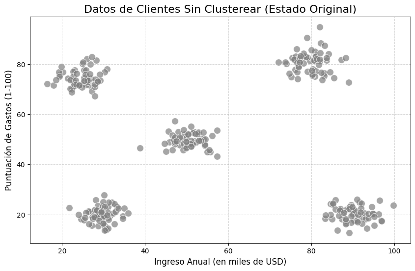
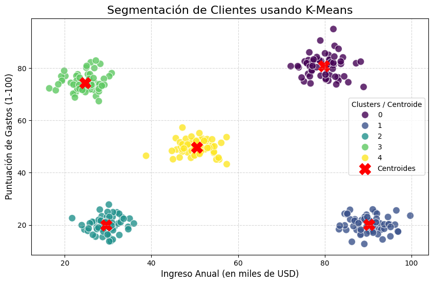
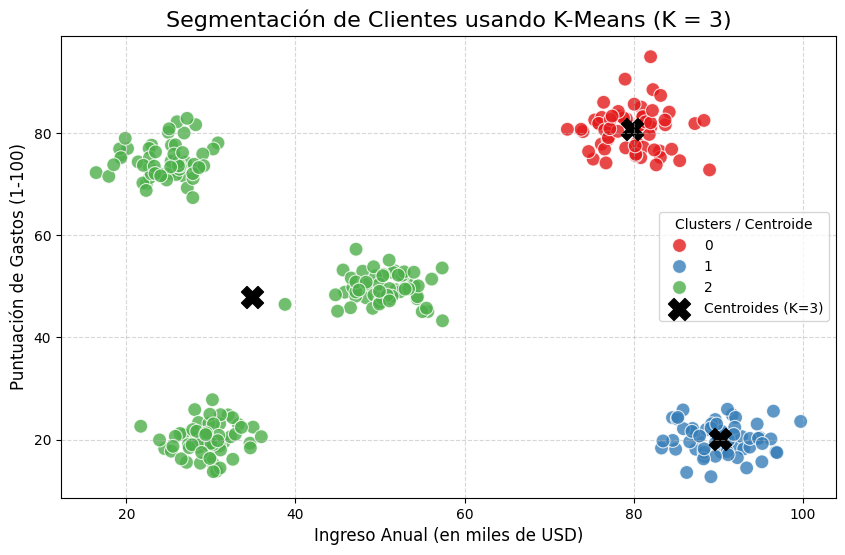

## Introducción

El siguiente texto sirve como introducción a la teoría de clustering, un método de aprendizaje no supervisado. Se analizan las motivaciones para querer agrupar cosas, y se avanza sobre los temas clásicos de clustering, como K-Means, Fuzzy C-Means, y en artículos posteriores se introducen temas más avanzados como *Kernel Clustering* y *Neural Network Based Clustering*.

## Parte 1. ¿Para qué agrupar?

Resulta interesante la idea de agrupamiento desde un punto de vista conceptual. Los seres humanos tienen la tendencia a agrupar cosas en el día a día, evidenciado por nuestra gran capacidad de detección de patrones. Como va a ser moneda corriente a lo largo de estas entradas, el clustering se inspira precisamente en nuestra capacidad de construir grupos abstractos de cosas basados en algún tipo de característica común. Especialmente importantes resultan estas habilidades en un mundo lleno de datos, que se pueden volver imposibles de manejar a mano cuando su magnitud aumenta. Este problema vienen a solucionar los algoritmos de clustering.

Nos hacemos la pregunta motivadora: **¿puede una computadora identificar patrones?**

*Nota: Nada de este artículo contiene trabajo original. Se citan de fuentes las clases y diapositivas de Inteligencia Computacional de la Universidad Nacional de Mar del Plata, Facultad de Ingeniería, y el libro "Clustering" de Rui Xu y Donald C. Wunsch. Para quien quiera ahondar más en estos temas, se recomienda fuertemente su lectura.*

## Parte 2: Clusters

Partamos de una base, ¿qué es un cluster? Las definiciones varían, pero propongo las siguientes como para tener una base común desde la cual avanzar:

- Un cluster es un conjunto de entidades que son parecidas, y entidades de diferentes clusters que no son parecidas.
- Un cluster es un agregado de puntos en el espacio de prueba de forma tal que la distancia entre dos puntos cualesquiera dentro de un cluster es menor que la distancia entre cualquier punto en el cluster a uno no en él.

Las definiciones pueden ser confusas a primera mirada, pero van a esclarecerse a medida que avancemos con este artículo. Especialmente quiero hacer énfasis en la segunda definición, porque ya nos habla de un concepto importante: la distancia intracluster y la distancia intercluster (o, en términos más académicos, la homogeneidad interna y la separación externa). Acá debería aparecer una pregunta importante: ¿qué significa que un punto esté más cercano a otro? O dicho en otras palabras, ¿qué implica que dos puntos sean parecidos? La respuesta a esto no es para nada trivial, y va a ser de fundamental importancia en los diferentes algoritmos y ejemplos que veamos.

### Parte 2.1. La importancia de las características

Siendo este el primer artículo en el blog, me parece importante hacer un paréntesis respecto a clarificar de qué hablamos cuando hablamos de características, y por qué son tan importantes.

Las características o atributos de un conjunto de datos son representaciones de algún concepto o cosa física del mundo real, resumido en un número. Por ejemplo, podemos considerar un conjunto de datos de flores, donde el largo de sus pétalos es una característica. De esta forma, le estamos dando cierta "personalidad" a los datos en función de sus atributos, y también le estamos dando forma al problema al elegir qué atributos usar. Resulta importante entonces saber qué atributos usar dentro de un conjunto de datos. Si queremos agrupar flores según su tamaño, ¿nos importa su color? La respuesta a esto tampoco es trivial, pues el color puede ser un factor funcional al tamaño de una flor (disculpen al autor por cualquier información errónea debido a su falta de conocimiento de flora). El punto de esto es que la elección de características es muy importante, dado que su correcta formación puede darnos el agrupamiento clave que estábamos buscando, y nos permite omitir información superflua. También, visto desde otra perspectiva, al utilizar características que a priori parecen no tener relación, pueden aparecer relaciones ocultas que el usuario no encontró a ojo desnudo. Volviendo a la idea del largo de los pétalos de una flor, un lector despierto puede haber notado que presentamos implícitamente la primera idea de parecido. En mi conjunto de datos las flores se agrupan por tamaño de pétalo. ¿Por qué? Porque quiero, y porque me sirve para el dominio de mi problema. El algoritmo de clustering entonces, debería agrupar por estas características. No perdamos de vista que es posible acotar el problema hasta llegar a algo que nos sirva.

### Parte 2.2. Medidas de proximidad

Con la introducción de qué es un cluster y qué son las características, y por qué son importantes, resuelta, vayamos a la siguiente cuestión que nos compete: ¿de qué hablamos cuando hablamos de cercanía?

Como les adelanté previamente, esto no es una pregunta trivial. Dependerá mucho de los algoritmos utilizados y del contexto del problema. Presento entonces el problema que nos acompañará durante este artículo: un conjunto de datos de clientes basado en sus ingresos anuales y su puntuación de gastos (*spending score*). Este conjunto de datos nos permite ver, en función de cuánto cobra un cliente, su comportamiento de gastos del 1 al 100, 1 siendo clientes conservadores respecto a gastos, y 100 un cliente con alta propensión al gasto, que compra de manera frecuente o adquiere productos de alto valor. El conjunto de datos de prueba se puede ver en la siguiente imagen:

Resulta intuitivo al usuario leyendo esto cuáles son los grupos, se pueden ver rápidamente 5 muy marcados. ¿Y cuál es la forma en la que los estamos agrupando mentalmente? Pues por su distancia euclidiana, claro. En este gráfico de dos dimensiones podemos decir que un punto está cerca o lejos de otro calculando la distancia euclidiana entre dos puntos. ¿Existen otras medidas de distancia? Sí, pero por ahora nos quedaremos con esta. Un problema que aparece con la distancia euclidiana es que tiende a formar clusters hiperesféricos, pero no nos vamos a preocupar de eso por el momento. ¿Qué ocurre cuando tenemos problemas $n > 3$ dimensionales? En esos casos la medida de distancia sigue funcionando, pero perdemos la capacidad de visualización.

#### Parte 2.2.1. Distancia euclidiana

Resulta de interés detenernos un momento para hablar de esta métrica. La distancia euclidiana o norma $L_{2}$ es representada como:

$$
D(\mathbf{x}_{i},\mathbf{x}_{j}) = \left(\sum_{l=1}^d |x_{il}-x_{jl}|^2\right)^{1/2}
$$

Como no es el objetivo de este artículo, no vamos a detenernos mucho en esto, pero se puede demostrar que la métrica euclidiana cumple simetría, positividad, la desigualdad triangular y la reflexividad, lo que la hace efectivamente una métrica (perdonen el uso liberal de esta palabra previo a la demostración).

Un problema que aparece con la distancia euclidiana es que valores de características en unidades distintas a otras, o de gran valor y varianzas tienden a dominar las otras características. Una forma de lidiar con este problema es la normalización, precisamente la estandarización:

$$
x_{il} = \frac{x^*_{il}-m_{l}}{s_{l}}
$$

donde $x^*$ representa el dato crudo, y $m_{l}$ y $s_{l}$ representan la media y la desviación estándar respectivamente. Otra forma de normalización es la basada en el máximo y mínimo de los datos.

### Parte 2.3. Criterios

Como mencionamos previamente, la idea de un algoritmo de clustering es minimizar la distancia intracluster, es decir, la distancia entre puntos de un mismo cluster, y maximizar la distancia intercluster, la distancia entre puntos de clusters distintos. Para ello, necesitamos introducir un criterio que contemple todos los puntos en simultáneo. Para nuestro análisis, vamos a utilizar el *sum-of-squared-error* (SSE), un criterio que será útil para el análisis de K-Means posteriormente. Resulta también importante la definición de una matriz de particiones, es decir, una matriz que nos diga que un elemento está en un cluster o no. La llamaremos $\gamma_{ij}$ y se define como:

$$
\gamma_{ij} = \begin{cases} 
1 & \text{si } \mathbf{x}_j \in \text{cluster } i \\ 
0 & \text{otro caso} 
\end{cases}
$$

El SSE se define como:

$$
J_{s}(\mathbf{\Gamma}, \mathbf{M}) = \sum_{i = 1}^K \sum_{j = 1}^N \gamma_{ij} \|\mathbf{x}_{j} - \mathbf{m}_{i}\|^2
$$

donde $\mathbf{M}$ es la matriz de centroides, centros cartesianos de los posibles clusters que el algoritmo dado encuentre. El objetivo de todos nuestros algoritmos será minimizar la SSE.

## Parte 3. K-Means

Con toda la gimnasia matemática resuelta, podemos proceder a introducir el primer algoritmo de clustering a analizar, K-Means. El objetivo de K-Means es encontrar una partición ideal de los datos minimizando la SSE explicada anteriormente. ¿De dónde sale el $K$ de K-Means? De un valor que nosotros elegimos, llamado hiperparámetro. Los hiperparámetros son conjuntos de parámetros que el usuario de un algoritmo de machine learning puede ajustar basándose en heurísticas o algún otro criterio contextualmente apropiado. En este caso, el algoritmo nos pide que le digamos en cuántos clusters queremos que se agrupen los datos. Si volvemos al caso de ejemplo, podemos ver que existen 5 grupos bien definidos, por lo que idealmente elegiríamos un $K$ de 5. Pero también podríamos haber elegido uno de 2, o de 6. El punto es que los hiperparámetros caen bajo el criterio del usuario, y son muy contextuales.

Ahora bien, ¿cómo es el algoritmo de K-Means? Voy a proceder a describirlo en rigor matemático, pero luego veremos que no es tan complicado como los pasos indicarían. El objetivo es llegar a una matriz de pertenencia que indique claramente la pertenencia de cada dato a su cluster.

1. Se inicializan los $K$ centros de cluster ($\mathbf{M}$) de forma aleatoria o bajo algún criterio.
2. Asignamos cada dato al centro de cluster más cercano:

   $$
   \begin{aligned}
   \mathbf{x}_j \in C_l, \text{ si } \|\mathbf{x}_j - \mathbf{m}_l\| < \|\mathbf{x}_j - \mathbf{m}_i\| \\
   \text{para } j = 1, \dots, N, \, i \neq l, \text{ e } i = 1, \dots, K;
   \end{aligned}
   $$

3. Recalculamos los centros de cluster siguiendo la siguiente ecuación:

   $$
   \mathbf{m}_i = \frac{1}{N_i} \sum_{\mathbf{x}_j \in C_i} \mathbf{x}_j
   $$

   donde $N_{i}$ es la cantidad de datos en el cluster $i$.
4. Repetimos los pasos 2 y 3 hasta que las posiciones de los centros de cluster no cambien.

En resumen, lo que se hace es inicializar aleatoriamente los $K$ centros de cluster, luego se asignan los puntos a los centros basado en la distancia euclidiana, se actualiza la posición de los centros y se repite iterativamente hasta que los centros no cambien de posición. Finalmente llegamos a una matriz de pertenencia, una matriz binaria que indica la pertenencia de cada dato a un cluster. Si tenemos 4 datos y 3 clusters, la matriz quedaría de la siguiente forma:

$$
\mathbf{\Gamma} = \begin{bmatrix} 
1 & 0 & 0 & 1 \\ 
0 & 1 & 0 & 0 \\ 
0 & 0 & 1 & 0 
\end{bmatrix}
$$

Cabe destacar la naturaleza de la matriz: es una matriz binaria, solo acepta 0s y 1s. Esto es importante a tener en cuenta para cuando veamos el próximo método de agrupamiento.

Volviendo al ejemplo de los ingresos anuales y el *spending score*, se muestra a continuación el resultado de aplicar K-Means sobre esos datos:

La leyenda indica el color de cada cluster, y la X roja indica los centroides de cada uno. Como dijimos antes, $K$, la cantidad de clusters, es un hiperparámetro. Resulta de interés ver qué pasa si modificamos este número a uno no tan óptimo, como por ejemplo 3.

Podemos ver cómo la modificación del $K$ movió nuestros grupos a 3, con el centro del grupo 2 fuera de la zona de cualquier cluster. ¿Es esta una partición útil? Depende, quizás nos conviene agrupar datos del medio hacia la izquierda para delimitar un límite en los ingresos anuales, o quizás esto es basura para el usuario. Como siempre, el contexto importa.

### Parte 3.1. Limitaciones

Las principales limitaciones son las siguientes:

1. **Caer en óptimos locales:** El algoritmo no nos puede asegurar que vaya a caer en un óptimo global. De esta forma, diferentes puntos de inicio de los centroides nos darán convergencias distintas. En teoría, no existen métodos eficientes y universales para determinar las particiones iniciales. Un potencial método podría ser introducir un algoritmo genético, como el GKA (Krishna y Murty, 1999).
2. **El número de $K$:** K-Means asume que el usuario sabe el número óptimo de centros de cluster antes de empezar. Esto es fácil de notar en casos donde se puede visualizar la información, pero para datos multidimensionales, no es posible ver los datos y de ahí sacar los números de clusters. Entonces, la identificación de un $K$ óptimo es de suma importancia. El algoritmo ISODATA (Ball y Hall, 1967) intenta afrontar este problema.
3. **Robustez:** K-Means es sensible a *outliers* y ruido. El cálculo de los centros considera todos los datos, incluyendo los *outliers*. Incluso si un dato está muy lejos de un centro de cluster, se fuerza a pertenecer a algún cluster para el cálculo de posiciones.

## Parte 4. Fuzzy C-Means

Con la mayor parte de la gimnasia mental realizada en el algoritmo previo, voy a ir relativamente rápido con este método. Fuzzy C-Means es muy similar a K-Means, con una diferencia clave: la matriz de pertenencia ya no es de 0s y 1s, sino que toma valores continuos entre 0 y 1. Podemos decir que es una matriz difusa.

El proceso de Fuzzy C-Means es muy similar al de K-Means:

1. Inicializar los centros de cluster aleatoriamente o con algún criterio.
2. Se asigna el grado de pertenencia de cada dato a un centro de cluster siguiendo la siguiente expresión:

   $$
   m_{ki} = \frac{1}{\sum_{j=1}^{K} \left( \frac{d_{ki}}{d_{ji}} \right)^{\frac{2}{q-1}}}
   $$

   Notemos cómo aparece un $q$ en la ecuación: eso es el coeficiente de fuzzificación (hiperparámetro), una medida de qué tan "difusas" queremos que sean las asignaciones. Un $q$ tendiendo a $1$ transforma el método a algo más parecido a un K-Means. $d_{ki}$ son las distancias de un dato $i$ a un cluster $k$.
3. Se actualizan los centros de cluster con la siguiente expresión:

   $$
   \mathbf{c}_k = \frac{\sum_{i=1}^{N} m_{ki}^q \mathbf{u}_i}{\sum_{i=1}^{N} m_{ki}^q}
   $$

   donde $\mathbf{u}_{i}$ es el $i$-ésimo vector de datos de entrada.
4. Se repiten los pasos 2 y 3 hasta que la posición de los centros de cluster no cambie.

Como se ve, el procedimiento es el mismo que para K-Means, solo cambian las ecuaciones y el concepto de pertenencia. La idea es, nuevamente, llegar a una matriz de la forma:

$$
\mathbf{M} = \begin{bmatrix} 
0.85 & 0.10 & 0.05 & 0.45 \\ 
0.10 & 0.80 & 0.15 & 0.45 \\ 
0.05 & 0.10 & 0.80 & 0.10 
\end{bmatrix}
$$

donde ahora los valores son difusos en lugar de ser estrictos. Cabe destacar que los valores de las columnas deben sumar 1.

### Parte 4.1. Limitaciones

1. Similar a K-Means, pero más grave aún, Fuzzy C-Means tiene una alta sensibilidad a *outliers* y a ruido.
2. Convergencia a mínimos locales.
3. Mayor costo computacional.