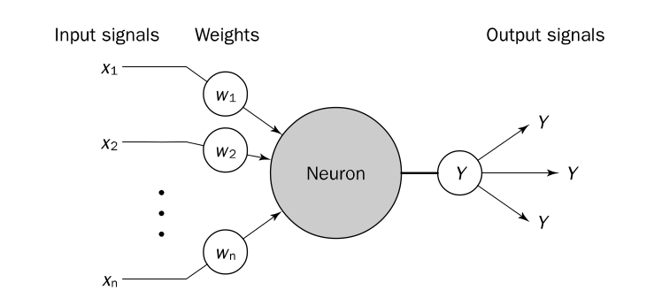

## Parte 1. ¿Qué es una neurona?
Puede no resultar obvio que el primer paso a aprender que es una red neuronal implica entender como nuestro propio cerebro funciona, pero es una pieza de información clave para desarrollar la intuición necesaria para entender el complejo mundo de redes neuronales, así que vamos a ello. 
El cerebro consiste de un conjunto de muchísimas celulas nerviosas conectadas, llamadas neuronas. El cerebro humano incorpora casi 10 billones de neuronas y 60 trillones de conecciones, las llamadas _sinapsis_. Señales son propagadas de una neurona a otra mediante complejos procesos electroquimicos que generan un cambio en el potencial del cuerpo de la neurona. Una vez que este potencial supera un umbral, se dispara un impulso electrico, el potencial de acción, que es enviado a través del axón, una fibra larga que conecta neuronas entre si.  

## Parte 2. El perceptron simple
¿Como podemos modelar el elemento más simple de una red neuronal? Mediante el peceptrón simple. Es la unidad básica de una red neuronal, y sienta las fundaciones necesarias para el análisis de redes neuronales más complejas a ser analizadas posteriormente. 

El modelo es el mostrado en la imagen. Tenemos cierta $n$ cantidad de entradas, ponderadas cada una por pesos $w_{i}$. En 1943, Warren McCulloch y Walter Pitts propusieron una simple idea que es la base de las redes modernas: el perceptron computa la suma ponderada de sus entradas; si el resultado es menor a un valor umbral $b$, la neurona no se activa (salida igual a $-1$). Si en cambio, la suma ponderada supera el umbral, la neurona se activa, indicando una salida de $1$. En otras palabras, la neurona usa la siguiente funcion de activacion:
$$
X = \sum_{i=1}^{n} x_i w_i
$$
$$
Y = \begin{cases} 
+1 & \text{if } X \geqslant \theta \\ 
-1 & \text{if } X < \theta 
\end{cases}
$$

donde $X$ es el resultado de la suma ponderada de las entradas, e $Y$ la salida. Este tipo de activación lleva el nombre de _activacion por signo_, que lo que indica es que la neurona simplemente entrega un signo dependiendo de si supera el umbral o no. Otra manera de expresarlo seria como
$$
Y = sign(\sum_{i = 1}^n x_{i}w_{i} - b)
$$
Existen otras funciones de activacion, como la sigmoidea y la lineal. 

Cabe destacar algo importante: las salidas, independientemente de la función de activación que usemos, son salidas binarias. Solamente pueden "distinguir" entre dos clases. Dependiendo de que sea la salida, está en una clase o en la otra. Esto genera que el perceptron simple separe el espacio del problema con un hiperplano (independientemente de la dimensionalidad del problema), lo que en consecuencia hace que solo sea útil en problemas donde los datos puedan ser linealmente separables. 

### Parte 2.1. ¿Pero como aprende nuestro simple perceptron?
El perceptron es un excelente caso introductorio porque nos permite mostrar un algoritmo de aprendizaje bastante sencillo. Acá tenemos que mencionar que los algoritmos de aprendizaje son _supervisados_, es decir, tenemos una salida con la cual comparar lo que nos da el perceptron. Esto nos va a permitir tener una nocion del _error_.  

Sin más preambulo, veamos como aprende el perceptrón.
Las entradas al perceptron son fijas, son nuestros datos. Pero lo que podemos modificar son los pesos por los que las entradas se ven atravesados. Sea $w_{ij}$ el peso de una entrada $i$. Se actualizara ese peso mediante la siguiente formula
$$
w_{ij}(n+1) = w_{ij}(n) + \Delta w_{ij}(n)
$$
donde $\Delta w_{ij}(n)$ es lo que llamamos la Regla Delta, y tiene la siguiente forma
$$
\Delta w_{kj}(n) = \eta e_{k}(n) X_{j}(n)
$$
Siendo $\eta$ el learning rate del perceptron, otro **hiperparametro** a configurar, y $e_{k}(n)$ el termino del error definido como
$$
e_{k}(n) = t_{k}(n) - y_{k}(n)
$$
donde $t_{k}$ es la salida esperada, e $y_{k}$ es la salida real del perceptron. Si son iguales, el error sera nulo. De las ecuaciones se puede identificar que si no hay error, los pesos no cambian. 

### Parte 2.2. Detalles algoritmicos

Con la introduccion conceptual del perceptron ya realizada, podemos entrar en algunos detalles del algoritmo. Al iniciar el entrenamiento, se suelen iniciar los pesos de forma aleatoria. 
En el contexto de redes neuronales se habla de _epocas_, que son una pasada de todos los datos de entrada. Cuando se cumple la pasada de datos, se dice que paso una epoca. El criterio de detencion del algoritmo puede ser por cantidad de epocas, o bien observando que si paso una epoca y los pesos no cambiaron, podemos considerar al problema resuelto. 

##  Conclusiones
El perceptron simple es de alto interés conceptual, dado que nos permite dar los primeros pasos en el tema de redes neuronales, aunque rápidamente podamos ver sus limitaciones (datos linealmente separables). No obstante, es importante empezar por acá antes de dar el salto matemático y conceptual que serán las redes multicapa. 

## Fuentes
Parte del articulo fue escrito tomando informacion del libro Artificial Intelligence, A Guide to Intelligent Systems de Michael Negnevitsky, y mis notas de la cursada de Inteligencia Computacional, por lo que las notaciones de acá y las del libro pueden ser ligeramente diferentes.

## Links
Se adjunta un link con código para representar un perceptron simple intentando aprender la funcion AND: [Google Colab Perceptron Simple](https://colab.research.google.com/drive/1-32C08gA2qTxSHv-iMVnBhf08YA_TAuG#scrollTo=78baa348)